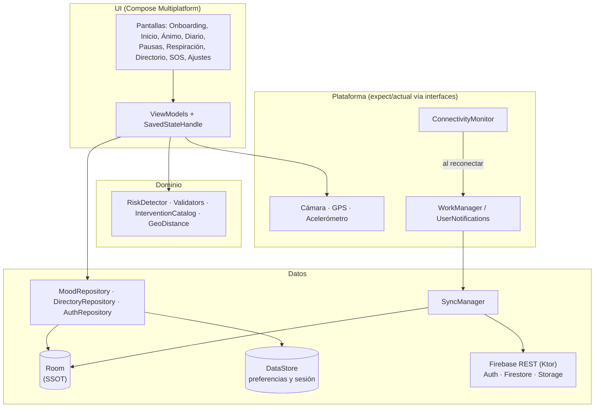
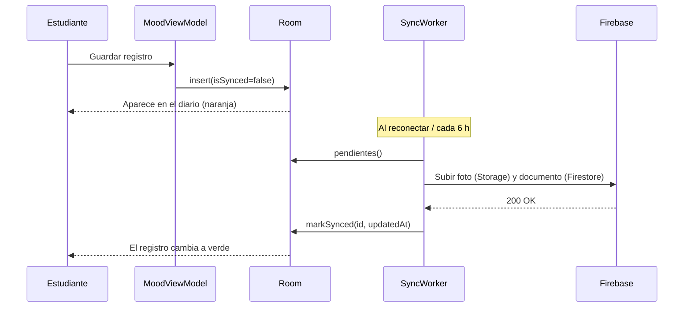

# Arquitectura

## Capas

## Flujo offline-first

- La UI **solo lee de Room** (Flow). La nube nunca se lee directamente desde la UI.
- `markSynced` solo marca si `updatedAt` no cambió mientras se subía, para no perder ediciones.
- Borrar un registro lo marca `isDeleted`; el sync borra en la nube y después en Room.
- `SyncManager` usa un `Mutex` para evitar dos sincronizaciones a la vez y renueva el token si expiró.

## Ciclo de vida

- Cada pantalla tiene su ViewModel (Koin). El borrador del registro de ánimo vive en `SavedStateHandle`, así que no se pierde al rotar ni si el sistema mata el proceso.
- Estados de UI pequeños (página del onboarding, casillas) usan `rememberSaveable`.
- Los sensores se exponen como `Flow` (`callbackFlow`) y se desregistran cuando la pantalla deja de recolectarlos.

## Seguridad

- Rutas en la nube: `users/{uid}/moods/{id}` y `users/{uid}/photos/{id}.jpg`. Las reglas de `firebase/` solo permiten acceso al dueño y validan tipos y tamaños.
- Claves de Firebase y keystore fuera de git (`local.properties`, `keystore.properties`).
- `android:allowBackup="false"` y `data_extraction_rules` excluyen la base de datos, las preferencias y las fotos de las copias en la nube y de la transferencia entre dispositivos.
- Fotos guardadas en almacenamiento privado, comprimidas y sin metadatos GPS.
